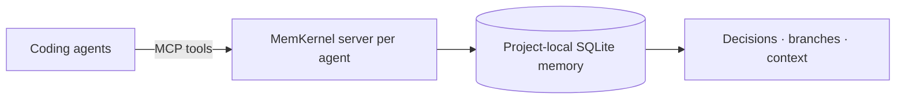

# MemKernel

<p align="center">
  
</p>

<p align="center">
  <a href="https://github.com/varadganjoo/MemKernel/actions/workflows/ci.yml"></a>
  <a href="https://pypi.org/project/memkernel-mcp/"></a>
  <a href="https://pypi.org/project/memkernel-mcp/"></a>
  <a href="LICENSE"></a>
</p>

**Persistent, branchable project memory for coding agents.**

Save a decision in one session and retrieve it in the next. Give cooperating agents
working on the same project a shared place for decisions, findings, and blockers.

MemKernel runs locally with Python, SQLite, and MCP. Agents explicitly save and
retrieve memory through tools; it does not automatically import their chat histories.

[Install](#install) · [Choose your agent](#connect-your-agent) · [Try it](#try-it-in-two-sessions) · [Integration guide](docs/integrations.md) · [Technical reference](docs/reference.md)

> **Experimental:** start with a disposable project. Keep secrets and personal data out
> of memory, and review what agents save. Memory is untrusted input, not authority.

<a id="quickstart-three-commands"></a>

## Install

Python **3.11–3.14** is supported; **3.14** is recommended. Install the agent app you
want to use and sign in to it first.

With [uv](https://docs.astral.sh/uv/getting-started/installation/), install MemKernel
in its own isolated Python environment:

```bash
uv tool install --python 3.14 memkernel-mcp
```

Alternatively, use `pipx install memkernel-mcp`, or `pip install memkernel-mcp`
inside an existing virtual environment.

**Use the package name `memkernel-mcp`.** The separate `memkernel` package on PyPI
belongs to another author. Do not install both into the same environment.

## Connect your agent

Run the command for your agent **from your project's root directory**. You can
connect one agent or several; you do not need to install all of them.

### Codex desktop, CLI, and IDE extension

```bash
memkernel attach codex
```

This updates `~/.codex/config.toml`, shared by the local desktop app, CLI, and IDE
extension on the same computer. The connection is global; each project discovers
its own local memory database. Restart the desktop app or start a new CLI/IDE session
after attaching.

In the CLI, `codex mcp list` checks registration; `/mcp` in an interactive session
shows active servers. In a new project chat, ask Codex to call
`memkernel_query_state` to check the live connection.

### Claude Code

```bash
memkernel attach claude-code
```

This writes the project's `.mcp.json`. Restart Claude Code in that project and
approve the MemKernel server if prompted. Use `/mcp` to check that it is connected.
Repeat the attach step for other projects.

### Cursor

```bash
memkernel attach cursor
```

This writes `.cursor/mcp.json` in the project. Open that project in Cursor, enable
MemKernel in Cursor's MCP settings, and start a new agent chat. Repeat the attach
step for other projects.

### Antigravity

```bash
memkernel attach antigravity
```

This updates Antigravity's MCP configuration under `~/.gemini/`. Refresh its MCP
servers or restart the app. The configuration is global and discovers memory per
project. For config locations and headless permissions, see the
[integration guide](docs/integrations.md#antigravity).

### Several agents at once

```bash
memkernel attach claude-code cursor codex
```

Use `memkernel attach all` to include Antigravity. Each agent runs its own server;
agents pointed at the same project database share memory on that computer.

### Other MCP clients and Python agents

Other clients that support **local stdio MCP servers** can launch
`memkernel serve`. Give each client a distinct `MEMKERNEL_AGENT_ID`, and ensure
its working directory is the project root or set an explicit `MEMKERNEL_DB`.

For JSON/TOML examples, absolute interpreter paths, and the in-process Python API,
see [manual configuration](docs/integrations.md#manual-configuration).

### Check the connection

From the project root, run:

```bash
memkernel doctor
```

This checks the local database, its hash chain, a real MCP server startup, and
agent configurations. Missing agents are reported as not attached; you only need
the ones you use. Then inspect saved memory with:

```bash
memkernel status
```

`attach` preserves other MCP entries, backs up existing global configs, creates
`.memkernel/`, and adds it to `.gitignore` when the project root contains `.git`.
Preview changes with `memkernel attach codex --dry-run`.

**Cold start troubleshooting:** Codex gets a 120-second startup timeout from
`attach`. For a slow Claude Code startup, see the
[timeout instructions](docs/integrations.md#troubleshooting).

## Try it in two sessions

In a disposable project, ask your connected agent:

> Use MemKernel to remember this project decision: our test fixtures use SQLite
> because they must run offline. Save it with the key `test.database`.

Start a **new chat in the same project** and ask:

> Query MemKernel. What database do our test fixtures use, and why?

The second session should retrieve the saved decision without the first chat's
history. Run `memkernel status` to inspect what was actually stored. A different
connected agent can query the same database on that computer too.

## What it gives you

| Capability | What it means in practice |
|---|---|
| Persistent decisions | Keep a decision and its rationale available across sessions. |
| Memory branches | Explore an investigation separately and compare it with `main`. |
| Rollback | Undo an investigation's memory changes while retaining audit history. Your code files are unaffected. |
| Context compaction | Condense recorded history into bounded snapshots while preserving folded state. |
| Local coordination | Cooperating agents can lease resources and share blockers. Leases do not prevent direct file edits. |

## How it works



Memory lives at `<project>/.memkernel/memkernel.db`. With discovery enabled,
MemKernel finds the nearest parent containing `.memkernel/` or `.git`.
Keep the database on a local disk and out of version control.

### Coordination notices and signed folder exchange

Separate laptops keep separate databases. Optional signed folder exchange shares
**coordination notices**, such as "I'm working on authentication", through an
operator-managed folder. It is off unless configured and requires no hosted
MemKernel service.

It does **not** sync full memories, decisions, branch history, leases, or fencing
tokens. Direct LAN memory sync is not currently available.
See [team setup and recovery](docs/team-coordination.md) and the
[notice reference](docs/reference.md#coordination-notices-and-signed-folder-exchange).

## Safety and trust boundary

MemKernel is experimental software. Local agent identities are self-asserted, and
agents with filesystem access can read or modify local data. Treat stored and
imported text as untrusted input.

Leases coordinate cooperating agents; they do not lock source files. Signed
notices authenticate configured peers but do not encrypt notice contents or
enforce distributed locks. Use OS permissions, keep backups, and review sensitive
actions independently.

Read the [full trust boundary and read-only setup](docs/reference.md#safety-and-trust-boundary)
before using shared or sensitive projects.

## Results

The repository includes [recorded live-agent runs](evidence/live-agents/20260928T161716Z/REPORT.md)
and [reproducible benchmarks](docs/reference.md#results). The recorded workflow
covers coordination, decisions, branching, rollback, and later recall.

See [verified client versions](docs/integrations.md#verified-configurations) for
the distinction between live runs and configuration-only coverage.

## Documentation

- [Agent integrations and troubleshooting](docs/integrations.md)
- [MCP tools, architecture, concepts, and benchmark details](docs/reference.md)
- [Signed team coordination, backups, and recovery](docs/team-coordination.md)
- [Whitepaper](docs/whitepaper.md)

## Development

From a source checkout, create a virtual environment and install development dependencies:

```bash
uv venv
uv pip install -e ".[dev]"
uv run pytest
```

See the [examples](examples/) for local simulations that need no agent subscription.

## Limitations

- Local SQLite coordination runs on one host; network filesystems are unsupported.
- Cross-machine exchange covers signed notices, not complete memory.
- Branch conflicts need an agent or human decision; there is no automatic merge.
- Resource leases are advisory for filesystem edits.
- Experimental software with no enterprise security certification.

## License

[MIT](LICENSE).

