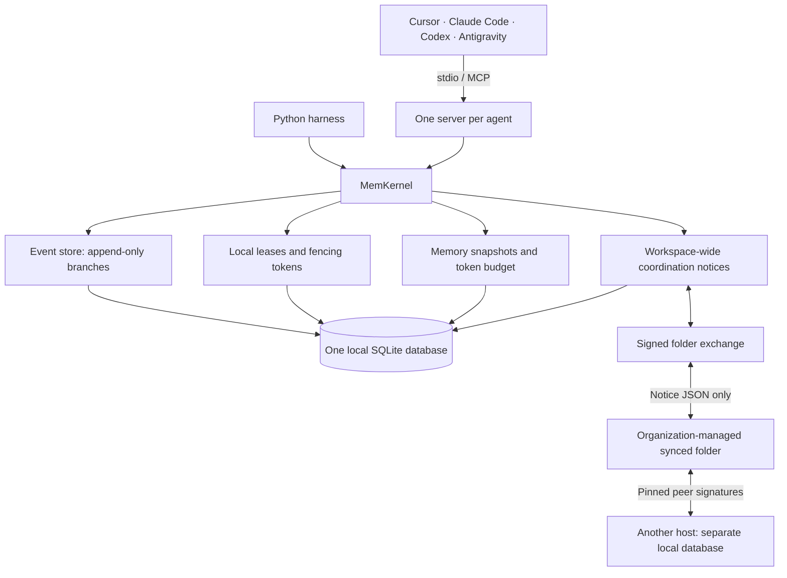

# Technical reference

For installation and agent setup, start with the [README](../README.md) and
[integration guide](integrations.md). Commands below run from the repository root.

**An event-sourced, branchable memory kernel for teams of coding agents, served over the Model Context Protocol.**

Cursor, Claude Code, Codex and your own harnesses each keep their own chat
history. None of them knows what the others decided, which files they are
editing, or which "fact" was already disproven three turns ago. MemKernel gives
all of them one shared memory with the following properties:

- **Deterministic.** State is a pure fold over an append-only, hash-chained event log. Replaying the log reproduces the state exactly.
- **Branchable.** Agents fork a timeline to investigate, diff it against `main`, and roll it back when an experiment or a hallucination fails. Forks copy no rows.
- **Coordinated.** Leases coordinate cooperating agents. Fenced event appends reject expired, stale or foreign leases atomically; leases do not prevent direct filesystem edits.
- **Budgeted.** An autonomous GC compacts noisy tool output into semantic snapshots. In the benchmarks it keeps each agent's context under a token budget while preserving every decision.
- **Portable coordination.** Signed, workspace-bound notices move between local databases through an operator-managed folder. Peer trust, freshness, replay protection and bounded notice context are built in.

It is a plain Python package: SQLite (WAL) for storage, `pydantic` v2 for
schemas, and the official `mcp` SDK (`FastMCP` on 1.x, `MCPServer` on 2.x) for
the stdio server.

**Runs on Linux, macOS and Windows** with Python 3.11 through 3.14 (3.14 recommended). The
test suite passes on Windows 11 and on Linux (Debian 13) under Python 3.14.7, and CI covers
all three operating systems. It works with Claude Code, Codex CLI, Antigravity and Cursor.



Each agent runs its own server process. All of them share one database file,
and SQLite's `BEGIN IMMEDIATE` transactions serialize writers across processes.

### Safety and trust boundary

**Experimental software for testing agent capabilities.** Use disposable projects and
synthetic data first. Incorrect or sensitive memory can persist and affect other agents.
Review what agents store and act on, redact secrets before logging, and keep backups.

- **One local database per host and trust domain.** Keep SQLite on local disk.
  Network filesystems and distributed leases are not supported. Signed notice
  exchange authenticates pinned remote peers; local agent IDs remain self-asserted
  launch configuration. Use distinct
  IDs for cooperating agents and OS permissions to control access to the database,
  its directory, backups and WAL/SHM files.
- **Observe without writing.** Launch an observer with
  `memkernel-server --db /path/to/existing/memkernel.db --read-only`, or set
  `MEMKERNEL_READ_ONLY=true` in that agent's MCP configuration. This blocks mutation
  tools and opens an existing database with SQLite `mode=ro`. SQL authorization also
  blocks database attachment and changes to the read-only query setting. It cannot initialize a
  missing database or run background GC. Reads may still need SQLite WAL/SHM sidecars.
  This limits that server process; it does not stop an agent with direct file access
  from launching another writable process. Restrict that access at the OS level.
- **Fence resource-associated decisions.** Acquire a lease, renew it while working,
  then use `memkernel_fenced_append_decision` with its token. The session identity,
  token and expiry are checked in the same transaction as the memory append. Ordinary
  memory tools remain unfenced, and direct file writes are outside this protection.
- **Treat memory as untrusted data.** Stored text is never executed by MemKernel,
  but downstream agents can still follow injected instructions. Review consequential
  actions independently. The hash chain detects some tampering; it does not authenticate
  writers or protect against an attacker who controls the database file.

These controls are a deployment foundation, not an enterprise security certification.
For controlled teams on separate machines, follow the [deployment and recovery guide](team-coordination.md),
including peer verification, OS access controls, transport encryption and a pilot.

### Try it without an agent

From a checkout:

```bash
pip install -e ".[dev]"
```

```bash
pytest
```

Two simulations assert their invariants and exit non-zero on violation:

```bash
python examples/multi_agent_collaboration.py
```

```bash
python examples/rollback_on_hallucination.py
```

## Coordination notices and signed folder exchange

For a team setup, initialize local signing identities with `memkernel sync init`,
pin independently verified peers with `memkernel sync trust`, and set
`MEMKERNEL_SYNC_CONFIG` in each agent's MCP server entry. The server publishes
post/clear updates and polls the folder; it requires no hosted service. See the
[complete setup and operations guide](team-coordination.md).

`memkernel_sync_now()` reports publish/import failures, and
`memkernel_sync_status()` reports peer freshness and rejected transfers. Signed
mode rejects unsigned imports and unauthorized authors. Run
`python examples/signed_folder_sync.py` for a disposable two-database example
covering signatures, tampering and replay protection without network calls.

For a message like "I'm changing login, please coordinate before touching auth",
use `memkernel_post_notice(resource="service:auth", message="Changing login")`.
Every branch sees it in `memkernel_query_state().coordination_notices`. Branches
represent investigations; authors participate in them. Switching branches,
rollback and GC do not remove or restore workspace-wide notices.

A notice has an immutable UUID, author, logical resource, message, creation time
and expiry. Resources are case-sensitive names like `service:auth` or
`repo:frontend/login`, never absolute paths on someone's laptop. The default TTL
is one hour, with a range of one second to seven days. Expiry marks a notice
**stale**, which means check with the author. Only an explicit
`memkernel_clear_notice(notice_id)` marks it finished. To change a message or
extend its expiry, clear it and post another notice.

Two laptops keep **separate databases**. For manual exchange on unmanaged databases,
explicitly export selected notice IDs
with `memkernel_export_notices(notice_ids=[...])`, review the returned JSON,
transfer it using your existing trusted channel, then pass its JSON text to
`memkernel_import_notices(document=...)` on the other machine. Export without
IDs includes the entire board, including cleared notices. Send later exports
containing those cleared IDs so peers learn the work finished. Manual exchange
does not sync automatically, and an unreceived update remains unknown to the other machine.

Python harnesses use the same API through `kernel.notices`:

```python
notice = await kernel.notices.post(
    agent_id="alice", resource="service:auth", message="Changing login"
)
document = await kernel.notices.export_json(notice_ids=[notice.notice_id])
changed = await other_kernel.notices.import_json(document)
await kernel.notices.clear(notice.notice_id, agent_id="alice")
```

Run the complete two-database example with `python examples/portable_notices.py`.
It uses a temporary JSON file and makes no network or model calls.

The versioned format is `memkernel.notices/v1`. Imports are transactional and
idempotent. Conflicting immutable fields reject the whole batch. Clearing wins
over active records in either arrival order; concurrent clears converge on the
earliest clear timestamp without treating remote clocks as trusted ordering.
Absence from a batch never clears a notice. Each exchange is limited to 1 MiB
of UTF-8 JSON and 1,000 notices; export selected IDs to split larger boards.
Messages are limited to 4,096 characters.

**Trust and limits:** notices are advisory. Signed exchange pins peers and their
allowed authors; local agents share an OS trust domain. Manual imports and
unmanaged identities are self-asserted. Imported text remains untrusted data. Export includes notice
text, so review it for sensitive content. It excludes decisions, scratchpads,
local event IDs, leases and fencing tokens. Notices never enforce distributed
locks or prevent file edits. Keep SQLite on local disk; exchange JSON, not live
database files. No hosted MemKernel service is required.

Notices live in an additive auxiliary table, separate from the hash-chained
event log. Existing v1 databases are extended on writable open without changing
events; read-only sessions can still inspect databases that lack the table.
Notices are not in snapshots or the branch audit history, and GC does not compact
them. `context_tokens` includes visible notices, with their separate contribution
reported as `coordination_notice_tokens`. Clear finished notices to keep context
small. Query/context limits notice content to 1,000 estimated tokens by default;
`notice_page` explicitly reports omissions. Use `notice_resource`, `notice_offset`
and `notice_token_budget` to inspect more, or paginate `memkernel_list_notices`.
Cleared tombstones are retained; capacity and recovery procedures are in the team guide.

## MCP tools

| Tool | Purpose |
|---|---|
| `memkernel_query_state(branch_id="main", include_ephemeral=False)` | Consolidated memory as JSON: tasks, decisions, workspace facts, deprecated assumptions, blockers, claims, leases, coordination notices, recent events. |
| `memkernel_post_notice(resource, message, ttl_seconds=3600)` | Post a workspace-wide advisory. Expiry marks it stale. |
| `memkernel_clear_notice(notice_id)` | Explicitly clear your notice when finished. |
| `memkernel_list_notices(resource=None, include_cleared=False)` | Inspect active and stale notices, optionally cleared history. |
| `memkernel_export_notices(notice_ids=None)` | Export selected notices or the whole board, including clears. |
| `memkernel_import_notices(document)` | Atomically merge a trusted collaborator's JSON export. Returns changed-record count. |
| `memkernel_sync_now()` | Run preconfigured signed folder exchange and report failures. |
| `memkernel_sync_status()` | Inspect peer freshness, sequence and last error without refreshing liveness. |
| `memkernel_append_decision(decision_key, decision_value, rationale)` | Durable architectural decision. It survives compaction, and a new value supersedes the old one. |
| `memkernel_acquire_lease(file_path, timeout_seconds=60)` | Exclusive lease with a TTL. Returns a fencing token, or the current holder. |
| `memkernel_release_lease(file_path, fencing_token)` | Release. Returns `false` for a stale token. |
| `memkernel_heartbeat_lease(file_path, fencing_token)` | Extend a held lease. |
| `memkernel_fenced_append_decision(file_path, fencing_token, decision_key, decision_value, rationale)` | Record a decision only while the session agent holds the current, unexpired lease. The lease is recorded in event metadata. |
| `memkernel_fork_investigation(fork_branch_name)` | Fork the active branch at its head and switch to it. |
| `memkernel_checkout(branch_id)` | Switch the session's active branch. |
| `memkernel_rollback(target_event_id)` | Revert the active branch's live timeline to an event. History stays auditable. |
| `memkernel_history(limit=30)` | Recent live events, useful for picking rollback targets. |
| `memkernel_diff_branches(branch_a, branch_b)` | Merge base, divergent events, conflicting decisions and facts. |
| `memkernel_trigger_gc(target_branch="main")` | Compact now and report the token savings. |
| `memkernel_init_task(directive, constraints)` | Record the agent's task and constraints. |
| `memkernel_log_execution(command, exit_code, output, facts)` | Log tool output. A failure opens a blocker and a later success clears it. `facts` updates workspace state. |
| `memkernel_note(note)` | Ephemeral scratchpad turn. |
| `memkernel_list_branches()` | All branches, plus the session's active branch. |

## Concepts in one page

**Events.** An event is an immutable `EventEnvelope` with fields `event_id`
(globally monotonic), `sequence` (position in the branch lineage), `timestamp`,
`branch_id`, `agent_id`, `parent_event_id` (lineage predecessor), `event_type`,
`payload`, `metadata` and `hash = SHA-256(prev_hash ‖ canonical(event))`. The
event types are `AGENT_TASK_INIT`, `ARCHITECTURAL_DECISION`,
`FILE_CLAIM_ACQUIRED/RELEASED`, `TOOL_EXECUTION_LOG`, `AGENT_SCRATCHPAD`,
`SEMANTIC_SNAPSHOT`, `BRANCH_FORKED` and `ROLLBACK_TRIGGERED`. SQLite triggers
reject every `UPDATE` and `DELETE` on the event table.

**Branches.** A branch is a pointer (parent, fork point, head). Its lineage is
its parent's lineage up to the fork point, followed by its own events. Forking
copies no rows.

**Rollback.** A rollback is a compensating `ROLLBACK_TRIGGERED` event. The
*live* timeline is a left fold in which a rollback truncates back to its
target. Nothing is deleted, so the reverted events stay auditable and forkable.

**State.** `WorkspaceState = fold(live events)`. It holds tasks, decisions (with
rationale and provenance), active workspace facts, deprecated or overruled
assumptions, execution blockers, file claims, an execution digest, and insights.

**GC.** When `[latest snapshot] + [delta]` exceeds the token budget, older delta
events fold into a new `SEMANTIC_SNAPSHOT`, an exact serialization of the fold.
The invariant `fold(snapshot, delta) == fold(full history)` is tested. The
retained raw tail is bounded by both an event count and a token low-water mark,
and every automatic compaction must free at least a quarter of the budget, so
GC does not thrash.

**Leases.** Leases are time-bounded, and every grant carries a fencing token
that strictly increases per resource. `fenced_append` checks the token and
appends in one transaction, so an expired or foreign holder cannot commit
through that fenced event path. Ordinary memory appends and filesystem writes
remain outside the fence. Renewals require the configured holder identity.

## Results

These numbers come from `python benchmarks/run_benchmarks.py`. The full
methodology is in [the whitepaper](https://github.com/varadganjoo/memkernel/blob/main/docs/whitepaper.md#5-empirical-evaluation--benchmarks).

| Workflow | Events | Raw history tokens | MemKernel context tokens | Reduction | Snapshots | State equivalent |
|---|---:|---:|---:|---:|---:|:---:|
| single-agent-test-fix | 73 | 31,346 | 3,558 | 88.6% | 13 | yes |
| multi-agent-refactor | 99 | 33,598 | 2,360 | 93.0% | 13 | yes |
| lint-heavy-exploration | 73 | 42,445 | 3,459 | 91.9% | 19 | yes |

On a 50,000-event log, a warm (fast-path) context read takes 1.7 ms on Windows 11 and 1.1 ms on Linux, a fork at the head takes under 2 ms, and a cold open plus context read takes 21 ms on Windows 11 and 4.5 ms on Linux. Measured with Python 3.14.7 on Windows 11 (build 26200, SQLite 3.53.1) and in a Debian 13 container (SQLite 3.46.1) on the same workstation. The token results are the same on both platforms.

### Live agents, with evidence

`benchmarks/live_agents.py` drives the real Claude Code, Codex CLI and Antigravity CLIs on a
small repository with two failing tests. They coordinate only through MemKernel: leases,
decisions, a fork with a rollback, and recall from shared memory. The script saves their
transcripts, the event database, the code diff and the test results. The recorded run is
in [`evidence/live-agents/20260928T161716Z/REPORT.md`](https://github.com/varadganjoo/memkernel/blob/main/evidence/live-agents/20260928T161716Z/REPORT.md).
In that run, the concurrently started agents contended for the same file, one was refused
and took other work, both bugs were fixed, and the hash chain verified intact in an
independent Linux container.

## Repository layout

```text
memkernel/
├── core/events.py        event taxonomy, envelope schema, hashing
├── core/store.py         AsyncEventStore: WAL, lineage, fork, rollback, diff, verify
├── core/branch.py        pure lineage algebra: live fold, rollback planning, diff, chain verification
├── core/locks.py         LockManager: leases, heartbeats, fencing tokens
├── memory/state_view.py  WorkspaceState fold, context split, rendering
├── memory/gc.py          MemoryGCEngine, heuristic and LLM summarizers, daemon
├── memory/token_counter.py  tiktoken with a conservative regex fallback
├── kernel.py             MemKernel facade (atomic lease+claim, fenced appends)
├── server/mcp_server.py  MCP server over stdio
├── clients/adapter.py    MemKernelClient (in-process) and McpStdioClient
└── cli.py                `memkernel` command: attach, doctor, status, serve
examples/                 multi-agent and rollback simulations
benchmarks/               reproducible measurements and the live-agent harness
evidence/                 recorded live-agent run (transcripts, database, report)
docs/                     whitepaper and integration guide
tests/                    store, branching, locks, GC, server and stdio e2e
```

## Development

```bash
pytest
```

The suite runs offline and is deterministic. One opt-in test exercises
`LLMSummarizer` against a real OpenAI-compatible model:

```bash
MEMKERNEL_LIVE_LLM_TESTS=1 OPENAI_API_KEY=... OPENAI_LLM=<model> pytest -k live
```

## Limitations

- **Single host.** Coordination relies on SQLite file locking on one machine; network filesystems are not supported. A replicated log is future work (see the whitepaper).
- **Self-asserted identity.** `agent_id` comes from the server's launch configuration. MemKernel records provenance but does not authenticate agents; see the threat model.
- **O(lineage) operations.** Rollback, arbitrary-point forks and full replay are linear in lineage length. Context reads and forks at the head are not.
- **No automatic merge.** `diff` reports conflicts. Reconciling them is an agent's (or a human's) decision, recorded as a new `ARCHITECTURAL_DECISION`.

## License

MIT. See [LICENSE](https://github.com/varadganjoo/memkernel/blob/main/LICENSE).
